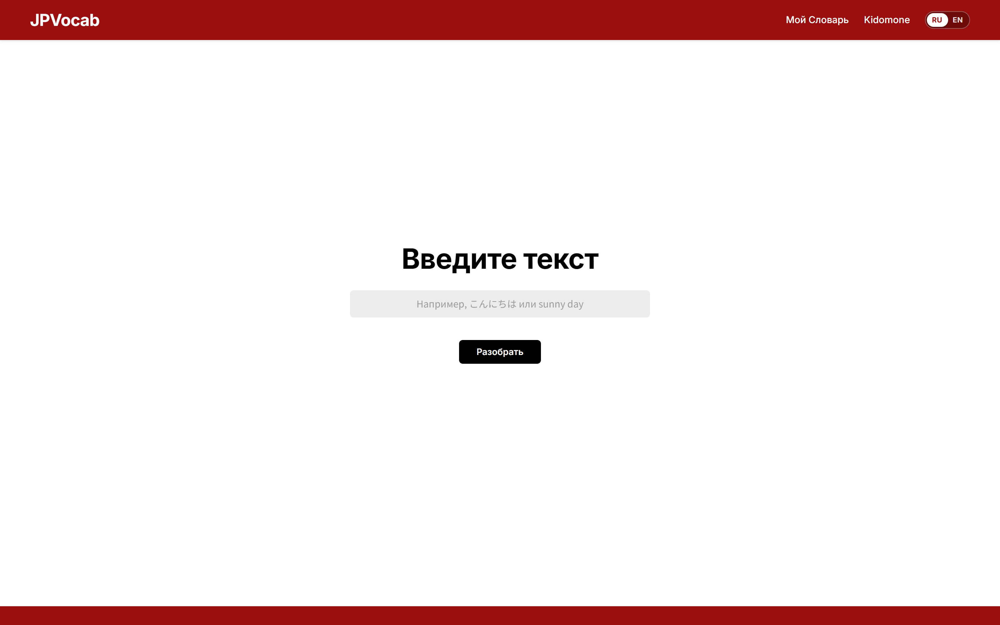
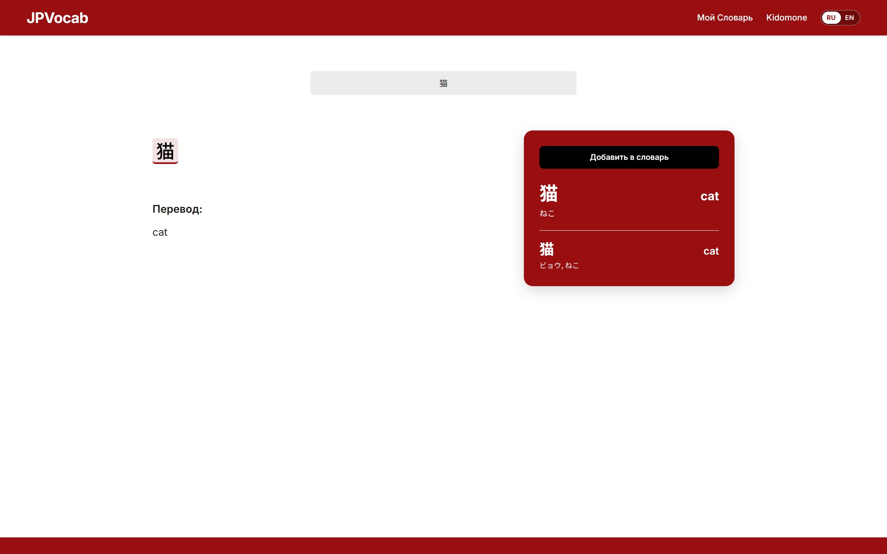
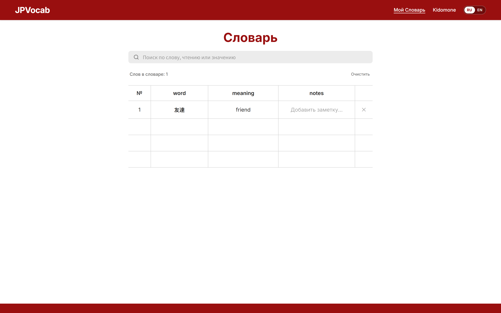

## JPVocab (Интерактивный японский словарь и анализатор текста)

---

## 1. Назначение приложения

**JPVocab** — это веб-приложение для изучающих японский язык, предназначенное для:
- Сегментации и разбора предложений на японском языке на составные лексические единицы (слова, частицы, связки).
- Детального изучения иероглифов (кандзи), входящих в состав слов, с их значениями и чтениями.
- Ведения персонального словаря пользователя с возможностью просмотра слов и добавления собственных заметок.

---

## 2. Основные пользовательские сценарии

1. **Разбор предложения (Текст -> Анализ)**
   - Пользователь переходит на главную страницу (`/`), вводит текст на японском(или английском) языке в строку ввода и нажимает кнопку **«Разобрать»**.
   - Приложение перенаправляет пользователя на страницу `/result`.

2. **Интерактивный анализ и изучение структуры предложения**
   - На странице результатов `/result` пользователь видит предложение, разбитое на кликабельные токены (слова).
   - Пользователь нажимает на интересующее слово в предложении — боковая карточка разбора мгновенно обновляется, показывая перевод слова, чтение хираганой и составные иероглифы (кандзи).

3. **Добавление слова в персональный словарь**
   - В карточке выбранного слова пользователь видит кнопку **«Добавить в словарь»**.

4. **Ведение словаря и добавление заметок (`notes`)**
   - Пользователь переходит в раздел **«Мой Словарь»** (`/vocab`).
   - В таблице отображаются сохранённые слова, их значения и поле заметок.
   - Поле **`notes`** является редактируемым: пользователь может кликнуть в ячейку и вписать произвольный комментарий или заметку.

5. **Авторизация**
   - Пользователь переходит на экран `/login`, вводит логин и пароль, после чего по нажатию кнопки возвращается на главную страницу.

---

## 3. Описание экранов

| Маршрут | Экран | Назначение |
| :--- | :--- | :--- |
| `/` | **Home** (Главная) | Поле ввода текста на японском(или английском) языке и запуск синтаксического разбора. |
| `/login` | **Login** (Авторизация) | Форма входа пользователя на фирменном красном фоне. |
| `/result` | **Result** (Разбор предложения) | Представление предложения по токенам, общий перевод и карточка слова с разбором кандзи. |
| `/vocab` | **Vocab** (Мой Словарь) | Табличное представление сохранённых слов с редактируемыми заметками. |

---

## 4. UI-библиотека и дизайн-система

- **UI-библиотека**: [Material-UI (MUI)](https://mui.com/) (`@mui/material`, `@emotion/react`, `@emotion/styled`).
- **Цветовая палитра**:
  - Тёмно-красный: `#990F0F` (хедер, карточка слова, фон экрана логина).
  - Контрастный чёрный: `#000000` / `#1E1E1E` (кнопки действий).
  - Фоновый серый: `#ECECEC` (поля ввода).
  - Основной фон: `#FFFFFF` (контент страниц).
- **Типографика**: шрифты `Inter` для латиницы/кириллицы и `Noto Sans JP` для японских кандзи и каны.
- **Адаптивность**: гибкая верстка с поддержкой мобильных и десктопных экранов.

---

## 5. Структура проекта

```text
JPvocab/
├── backend/                   # Серверная часть (FastAPI, PostgreSQL, SQLAlchemy)
│   ├── app/
│   │   ├── api/               # Маршруты REST API и центральный router.py
│   │   ├── crud/              # CRUD операции с базой данных
│   │   ├── models/            # SQLAlchemy ORM-модели
│   │   ├── schemas/           # Схемы валидации
│   │   ├── services/          # Сервисы анализа (SudachiPy, lemminflect, словари)
│   │   ├── config.py          # Конфигурация и переменные окружения
│   │   ├── database.py        # Подключение к PostgreSQL и фабрика сессий
│   │   └── main.py            # Точка входа FastAPI, CORS, lifespan
│   ├── .env.example           # Шаблон переменных окружения
│   ├── requirements.txt       # Зависимости
│   └── run.py                 # Скрипт запуска сервера
├── data/                      # Словари базы данных
│   ├── JMdict.db              # Японско-английский словарь
│   └── kanjidic2.db           # Словарь кандзи
├── docs/
│   └── screenshots/ 
│       ├── 01-home.png
│       ├── 02-result.png
│       ├── 03-vocab.png
│       └── 04-login.png
├── public/
│   └── favicon.svg            # Иконка приложения (кандзи 語)
├── src/
│   ├── components/            # Общие компоненты оформления
│   │   ├── Header.tsx         # Шапка с логотипом и навигацией
│   │   └── Layout.tsx         # Каркас страницы (хедер + футер)
│   ├── pages/                 # Экраны приложения
│   │   ├── HomePage.tsx       # Главная страница (/)
│   │   ├── LoginPage.tsx      # Авторизация (/login)
│   │   ├── ResultPage.tsx     # Результаты разбора (/result)
│   │   └── VocabPage.tsx      # Словарь (/vocab)
│   ├── mockData.ts        # Демонстрационные данные для разбора предложений и слов
│   ├── theme.ts           # Настройка темы Material UI (цвет, типографика)
│   ├── index.ts           # TypeScript интерфейсы
│   ├── App.tsx                # Клиентский роутинг (React Router)
│   ├── index.css              # Базовый CSS-reset
│   └── main.tsx               # Точка входа
├── index.html                 # HTML-шаблон с подключением шрифтов
├── package.json
└── tsconfig.json
```

---

## 6. Инструкция по запуску frontend

### Требования
- Node.js (версия 18+)
- `npm`

### Шаги запуска:

1. Перейдите в каталог frontend-проекта:
   ```bash
   cd JPvocab
   ```

2. Установите зависимости:
   ```bash
   npm install
   ```

3. Запустите сервер разработки:
   ```bash
   npm run dev
   ```
   Приложение откроется по адресу: [http://localhost:5173/](http://localhost:5173/)

4. Проверка сборки (typecheck + production build):
   ```bash
   npm run build
   ```
---
## 7. Настройка и запуск Backend

### 1. Подготовка базы данных (PostgreSQL)
Убедитесь, что служба PostgreSQL запущена, и создайте базу данных:
```sql
CREATE DATABASE jpvocab_db;
```

### 2. Настройка окружения и установка зависимостей
1. В папке `backend/` скопируйте шаблон переменных окружения:
   ```bash
   cp .env.example .env
   ```
2. Укажите в `.env` свои параметры подключения:
   ```env
   POSTGRES_HOST=localhost
   POSTGRES_PORT=5432
   POSTGRES_USER=postgres
   POSTGRES_PASSWORD=your_password
   POSTGRES_DB=jpvocab_db
   JMDICT_DB_PATH=data/JMdict.db
   ```
3. Установите зависимости:
   ```bash
   cd backend
   pip install -r requirements.txt
   ```

### 3. Создание таблиц в БД
Таблицы (`users`, `words`) создаются автоматически средствами SQLAlchemy при первом запуске сервера или тестов.

### 4. Запуск сервера
Запустите backend-сервер:
```bash
python run.py
```
* API будет доступно по адресу: [http://127.0.0.1:8000](http://127.0.0.1:8000)
* Интерактивная документация Swagger: [http://127.0.0.1:8000/docs](http://127.0.0.1:8000/docs)


## 8. Скриншоты экранов

### 1. Главная страница (/)


### 2. Экран разбора предложения (/result)


### 3. Экран словаря (/vocab)


### 4. Экран авторизации (/login)
