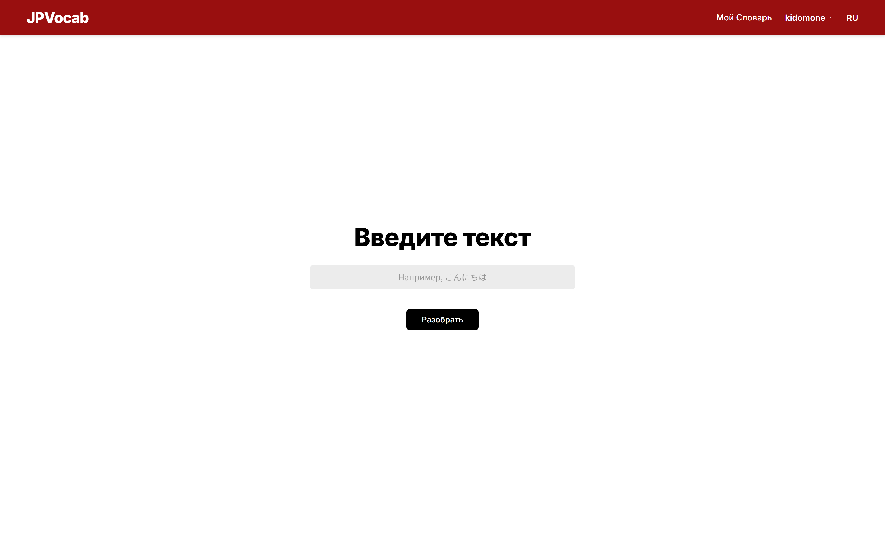
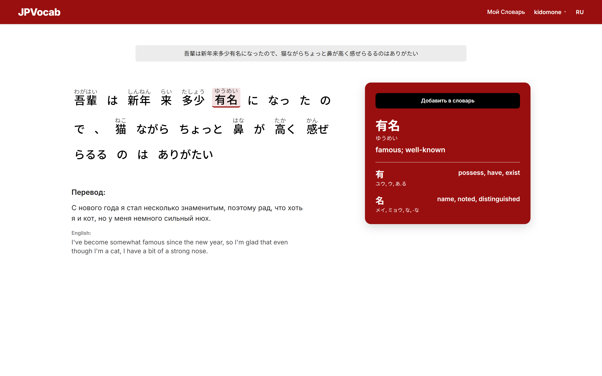
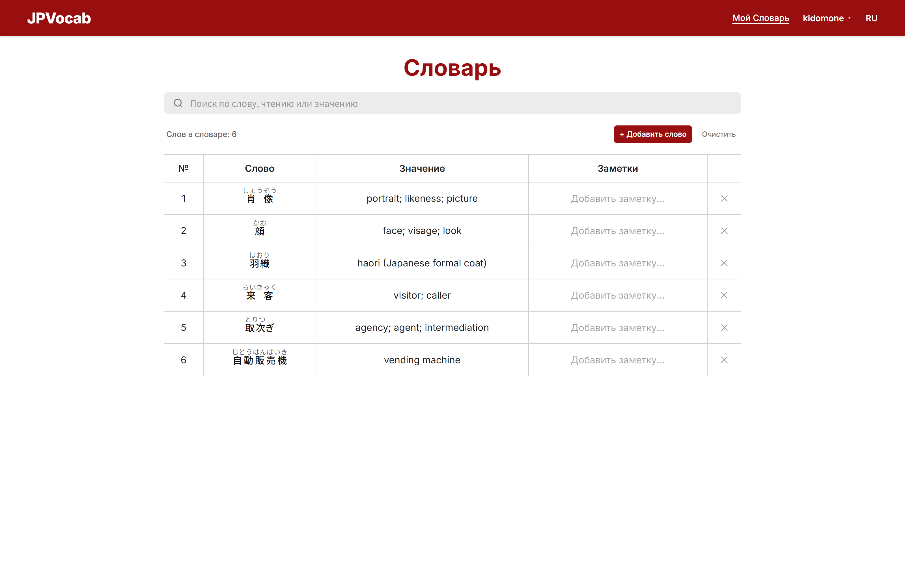
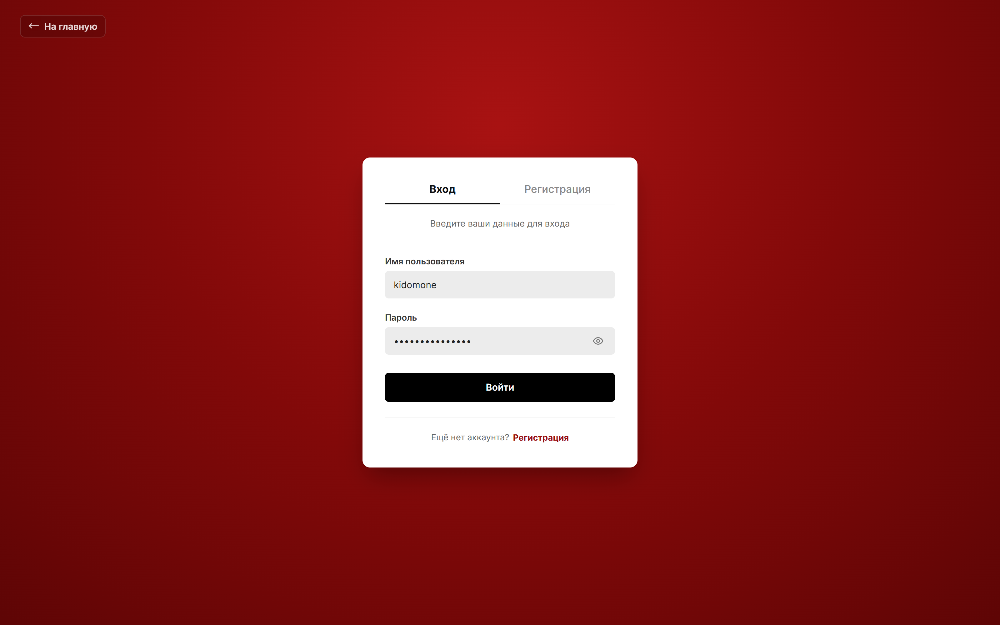

# JPVocab

Веб-приложение для разбора японских предложений и ведения личного словаря.  
Web application for Japanese sentence parsing and vocabulary management.


[Русский](#русский) | [English](#english)


---

# Русский

## Описание

JPVocab — сервис для тех, кто изучает японский язык и читает тексты в оригинале. Приложение делит текст на отдельные слова, показывает фуригану, переводит предложение, разбирает составные иероглифы и позволяет сохранять незнакомые слова в личный словарь.

### Возможности

* **Разбор предложения на слова:** разделение текста на токены и определение базовых форм через анализатор Sudachi.
* **Фуригана:** чтение каной отображается над иероглифами.
* **Разбор иероглифов:** для каждого слова показываются входящие в него кандзи, их значения и чтения.
* **Перевод предложения:** перевод на русский или английский язык.
* **Личный словарь:** таблица сохранённых слов с возможностью добавлять заметки, удалять записи и искать слова.
* **Поиск по словарю:** поиск по кандзи, чтению (хирагана/катакана), английскому значению и ромадзи.
* **Два языка интерфейса:** переключение между русским и английским (RU / EN).
* **Авторизация:** аккаунты пользователей (JWT) для хранения словаря в базе данных.

---

## Сценарии использования

### 1. Разбор предложения
1. Вставьте предложение на японском или английском языке в поле на главной странице и нажмите кнопку **«Разобрать»**.
2. Откроется страница с переводом предложения и списком интерактивных слов с фуриганой.
3. При нажатии на слово справа открывается карточка с его чтением, значением и списком входящих иероглифов.

### 2. Просмотр иероглифов в слове
1. Нажмите на интересующее слово в разобранном предложении.
2. В карточке слова отобразятся все кандзи, входящие в его состав, с переводом и чтениями.

### 3. Сохранение слова в словарь
1. В карточке слова нажмите кнопку **«Добавить в словарь»**.
2. Слово появится в разделе **«Словарь»**.
3. В таблице можно добавить к слову текстовую заметку (например, контекст или пример).

### 4. Поиск по словарю
1. Откройте раздел **«Словарь»**.
2. Введите в строку поиска иероглифы, чтение каной, ромадзи или перевод на английском. Таблица отфильтрует результаты.

---

## Скриншоты

### Главная страница
Ввод текста для разбора.


### Разбор предложения
Слова с фуриганой, перевод фразы и карточка выбранного слова с иероглифами.


### Словарь
Таблица сохранённых слов с заметками и строкой поиска.


### Вход в аккаунт
Форма авторизации и регистрации.


---

## Запуск проекта

### Требования
* Node.js 18+
* Python 3.10+
* PostgreSQL

---

### Установка и запуск

1. **Клонировать репозиторий:**
   ```bash
   git clone https://github.com/Kidomone/JPvocab.git
   cd JPvocab
   ```

2. **Установить зависимости фронтенда:**
   ```bash
   npm install
   ```

3. **Установить зависимости бэкенда:**
   ```bash
   cd backend
   pip install -r requirements.txt
   cd ..
   ```

4. **Настроить базу данных:**
   Создайте базу данных в PostgreSQL:
   ```sql
   CREATE DATABASE jpvocab_db;
   ```
   В папке `backend/` скопируйте `.env.example` в `.env` и укажите данные для подключения:
   ```env
   POSTGRES_HOST=localhost
   POSTGRES_PORT=5432
   POSTGRES_USER=postgres
   POSTGRES_PASSWORD=postgres
   POSTGRES_DB=jpvocab_db
   ```
   Таблицы создаются автоматически при первом старте бэкенда.

5. **Запустить фронтенд и бэкенд одновременно:**
   ```bash
   npm run dev
   ```
   * Фронтенд: [http://localhost:5173](http://localhost:5173)
   * Бэкенд API: [http://127.0.0.1:8000](http://127.0.0.1:8000)
   * Документация API: [http://127.0.0.1:8000/docs](http://127.0.0.1:8000/docs)

*(Для раздельного запуска используйте `npm run dev:front` и `npm run dev:back`).*

---

## Стек технологий

* **Frontend:** React 19, TypeScript, Vite, Material-UI, React Router.
* **Backend:** Python 3, FastAPI, SQLAlchemy, PostgreSQL, SQLite (словари).
* **Анализ текста:** SudachiPy (морфологический анализ), lemminflect (английские леммы).
* **Базы данных словарей:** JMdict, KANJIDIC2.

---
---

# English

## Overview

JPVocab is a web application for Japanese language learners. It splits sentences into words, displays furigana above kanji, translates sentences, breaks words down into component kanji, and lets users save words into a personal vocabulary list.

### Features

* **Sentence tokenization:** splits text into words and finds dictionary forms using Sudachi.
* **Furigana:** displays kana readings directly above kanji.
* **Kanji breakdown:** shows individual kanji characters, English meanings, and readings from KANJIDIC2.
* **Sentence translation:** translates sentences to Russian or English.
* **Vocabulary list:** table of saved words with editable notes, deletion, and search.
* **Vocabulary search:** search by kanji, kana, English meaning, or romaji.
* **Two UI languages:** switch between English and Russian (EN / RU).
* **Authentication:** user accounts (JWT) for saving vocabulary to the database.

---

## User Scenarios

### 1. Sentence Analysis
1. Enter a Japanese or English sentence on the home page and click **Analyze**.
2. View the sentence translation and interactive word tokens with furigana.
3. Click any word to open a card showing its reading, meaning, and component kanji.

### 2. Inspecting Kanji in a Word
1. Click a word in the parsed sentence.
2. The card shows each kanji character in that word along with its meaning and on/kun readings.

### 3. Saving a Word
1. Click **Add to dictionary** on the word card.
2. The word is saved to the **Dictionary** page.
3. Add custom notes (such as context or example usage) directly in the table row.

### 4. Searching the Dictionary
1. Open the **Dictionary** page.
2. Type kanji, kana, romaji, or English translation into the search bar to filter entries.

---

## Screenshots

### Home Page
Text input for analysis.


### Sentence Analysis
Words with furigana, sentence translation, and the selected word card.


### Dictionary
Table of saved words with notes and search.


### Sign In
Authentication and registration form.


---

## Getting Started

### Requirements
* Node.js 18+
* Python 3.10+
* PostgreSQL

---

### Installation and Run

1. **Clone the repository:**
   ```bash
   git clone https://github.com/Kidomone/JPvocab.git
   cd JPvocab
   ```

2. **Install frontend dependencies:**
   ```bash
   npm install
   ```

3. **Install backend dependencies:**
   ```bash
   cd backend
   pip install -r requirements.txt
   cd ..
   ```

4. **Configure PostgreSQL:**
   Create the database:
   ```sql
   CREATE DATABASE jpvocab_db;
   ```
   In the `backend/` directory, copy `.env.example` to `.env` and set connection settings:
   ```env
   POSTGRES_HOST=localhost
   POSTGRES_PORT=5432
   POSTGRES_USER=postgres
   POSTGRES_PASSWORD=postgres
   POSTGRES_DB=jpvocab_db
   ```
   Tables are created automatically on first backend startup.

5. **Start frontend and backend together:**
   ```bash
   npm run dev
   ```
   * Frontend: [http://localhost:5173](http://localhost:5173)
   * Backend API: [http://127.0.0.1:8000](http://127.0.0.1:8000)
   * API documentation: [http://127.0.0.1:8000/docs](http://127.0.0.1:8000/docs)

*(To run services separately, use `npm run dev:front` and `npm run dev:back`).*

---

## Tech Stack

* **Frontend:** React 19, TypeScript, Vite, Material-UI, React Router.
* **Backend:** Python 3, FastAPI, SQLAlchemy, PostgreSQL, SQLite (dictionaries).
* **Text Analysis:** SudachiPy (morphological analyzer), lemminflect (English lemmatization).
* **Dictionaries:** JMdict, KANJIDIC2.